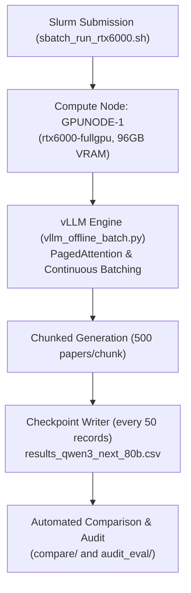

# Implementation Plan: Running Qwen3-Next-80B on DAU HPC Cluster (Folder: `qiwi`)

## 1. Executive Summary & Cluster Hardware

This implementation plan establishes the deployment and execution of **`Qwen3-Next-80B`** (MoE 80B total / ~3B active parameters) on the **Dhirubhai Ambani University (DAU) HPC Cluster** documented in [`DAU_user_Manual.pdf`](file:///Users/ap4320861gmail.com/Library/Mobile%20Documents/com~apple~CloudDocs/minor-project/DAU_user_Manual.pdf).

### Cluster Hardware & Partition Target:
* **Target Node**: `GPUNODE-1` (Tyrone Camarero RDA200A2G-424)
* **GPU**: **NVIDIA RTX PRO 6000 Blackwell Server Edition (96GB VRAM each, Qty: 2)**
* **Slurm Partition**: **`rtx6000-fullgpu`**
* **Slurm GRES Resource**: `--gres=gpu:rtx_pro:1` (or `gpu:rtx_pro:2`)
* **Operating System**: Rocky Linux 9.4
* **Master Node IP**: `10.100.71.161` (Login via SSH)
* **Pre-compiled Modules**: `anaconda3-2025-12-2`, `cuda-13.0`, `ollama`, `vllm`

> [!TIP]
> The **96GB VRAM** of the RTX PRO 6000 Blackwell easily accommodates the 80B parameter model in FP8 or INT4 quantization without offloading, while the ~3B active parameter MoE routing guarantees high generation speeds across the 12,236 paper corpus.

---

## 2. Scaffolded Structure (`qiwi/`)

The implementation has been scaffolded in the dedicated sub-folder **[`qiwi/`](file:///Users/ap4320861gmail.com/Library/Mobile%20Documents/com~apple~CloudDocs/minor-project/qiwi)**:

```
minor-project/
├── qiwi/
│   ├── input.csv                                 # Symlink to the 12,236 paper corpus
│   ├── prompt_cot.txt                            # Verified Chain-of-Thought prompt template
│   ├── requirements.txt                          # Cluster Python dependencies (vLLM, PyTorch, etc.)
│   ├── sbatch_run_rtx6000.sh                     # Slurm batch job script for rtx6000-fullgpu
│   ├── sbatch_vllm_server.sh                     # Slurm script for launching vLLM server
│   ├── vllm_offline_batch.py                     # High-throughput direct offline vLLM runner
│   ├── main.py                                   # Dual-backend runner (OpenAI & Ollama APIs)
│   ├── test_sample.py                            # Smoke test script (10 benchmark papers)
│   ├── README.md                                 # Cluster user guide (SSH, SCP, Slurm commands)
│   │
│   ├── compare/
│   │   ├── compare_utils.py                      # Text & DOI normalization utilities
│   │   ├── build_qwen_alignment_summary.py       # 4-way alignment: Qwen3 vs GPT-120B vs LLaMA vs Jev
│   │   └── QWEN3_MULTI_MODEL_ALIGNMENT_REPORT.md # Generated alignment & consensus report
│   │
│   └── audit_eval/
│       ├── evaluate_ground_truth.py              # Evaluates Qwen3 against 600 human-audited exclusions
│       └── audit_metrics_summary.txt             # Computed FNR & NPV metrics
```

---

## 3. High-Throughput Execution Architecture

To maximize the compute efficiency of the 96GB RTX PRO 6000 Blackwell GPU, we support two deployment modes:



### Mode 1: High-Throughput vLLM Offline Batch (Recommended for HPC)
* Script: [`qiwi/vllm_offline_batch.py`](file:///Users/ap4320861gmail.com/Library/Mobile%20Documents/com~apple~CloudDocs/minor-project/qiwi/vllm_offline_batch.py)
* Directly instantiates `vllm.LLM` on the GPU node.
* Uses PagedAttention with zero HTTP network overhead to process hundreds of papers concurrently.
* **Estimated Runtime**: ~10–20 minutes for all 12,236 papers on a single 96GB Blackwell GPU.

### Mode 2: Client-Server API Mode
* Script: [`qiwi/sbatch_vllm_server.sh`](file:///Users/ap4320861gmail.com/Library/Mobile%20Documents/com~apple~CloudDocs/minor-project/qiwi/sbatch_vllm_server.sh) + [`qiwi/main.py`](file:///Users/ap4320861gmail.com/Library/Mobile%20Documents/com~apple~CloudDocs/minor-project/qiwi/main.py)
* Starts a standard OpenAI-compatible API server on port 8000, queried asynchronously via Python.

---

## 4. Execution Workflow on DAU HPC Cluster

### Step 1: Copy Code to Master Node
```bash
scp -r qiwi gpt-oss-120b_pipeline/input.csv username@10.100.71.161:~/minor-project/
```

### Step 2: SSH into Master Node
```bash
ssh username@10.100.71.161
cd ~/minor-project/qiwi
ln -sf ../input.csv input.csv
```

### Step 3: Submit the Slurm Job
```bash
sbatch sbatch_run_rtx6000.sh
```

### Step 4: Monitor Output
```bash
squeue
tail -f qwen3_screening_*.out
```

### Step 5: Post-Processing & Benchmarking
```bash
python compare/build_qwen_alignment_summary.py
python audit_eval/evaluate_ground_truth.py
```
