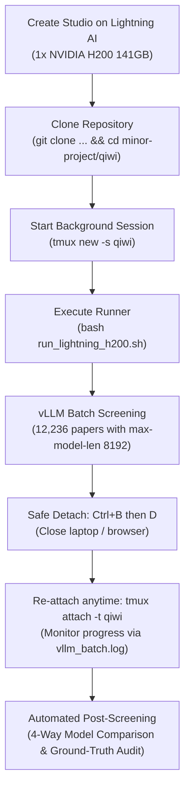

# Implementation Plan: Running Qwen3-Next-80B (Folder: `qiwi`)

## 1. Executive Summary & Hardware Profiles

This implementation plan establishes the deployment and execution of **`Qwen3-Next-80B`** (`Qwen/Qwen3-Next-80B-A3B-Instruct`, MoE 80B total / ~3B active parameters) across two high-performance compute environments:

1. **Lightning AI (Primary Target)**:
   * **GPU**: **1x NVIDIA H200 SXM (141GB HBM3e VRAM, 4.8 TB/s memory bandwidth)**
   * **Execution Environment**: Cloud Studio with persistent **`tmux`** session.
   * **Throughput Advantage**: Massive 141GB VRAM easily fits the full model with native BF16/FP8 weights, while 4.8 TB/s memory bandwidth and 3B active parameters allow continuous PagedAttention batching at hundreds of tokens/sec.
   * **Session Resilience**: Running inside `tmux` allows closing laptops, disconnecting network connections, and shutting browser tabs without interrupting the 12,236-paper screening process.

2. **Dhirubhai Ambani University (DAU) HPC Cluster (Alternative Target)**:
   * **Target Node**: `GPUNODE-1` (Tyrone Camarero RDA200A2G-424)
   * **GPU**: **NVIDIA RTX PRO 6000 Blackwell Server Edition (96GB VRAM each, Qty: 2)**
   * **Slurm Partition**: **`rtx6000-fullgpu`** (`--gres=gpu:rtx_pro:1` or `2`)
   * **Master Node IP**: `10.100.71.161` (Login via SSH)

---

## 2. Directory Structure (`qiwi/`)

The implementation is structured cleanly in the dedicated sub-folder **[`qiwi/`](file:///Users/ap4320861gmail.com/Library/Mobile%20Documents/com~apple~CloudDocs/minor-project/qiwi)**:

```
minor-project/
├── qiwi/
│   ├── input.csv                                 # Symlink/fallback to 12,236 paper corpus
│   ├── prompt_cot.txt                            # Verified Chain-of-Thought prompt template
│   ├── requirements.txt                          # Python dependencies (vLLM, PyTorch, etc.)
│   ├── run_lightning_h200.sh                     # Automated runner for Lightning AI (H200 + tmux)
│   ├── vllm_offline_batch.py                     # High-throughput direct offline vLLM runner
│   ├── main.py                                   # Dual-backend runner (OpenAI & Ollama APIs)
│   ├── test_sample.py                            # Smoke test script (10 benchmark papers)
│   ├── sbatch_run_rtx6000.sh                     # Slurm batch job script for DAU cluster
│   ├── sbatch_vllm_server.sh                     # Slurm script for launching vLLM server
│   ├── README.md                                 # Full execution guides (Lightning AI & DAU)
│   │
│   ├── compare/
│   │   ├── compare_utils.py                      # Text & DOI normalization utilities
│   │   ├── build_qwen_alignment_summary.py       # 4-way alignment: Qwen3 vs GPT-120B vs LLaMA vs Jev
│   │   └── QWEN3_MULTI_MODEL_ALIGNMENT_REPORT.md # Generated alignment & consensus report
│   │
│   └── audit_eval/
│       ├── evaluate_ground_truth.py              # Evaluates Qwen3 against 600 human-audited exclusions
│       └── audit_metrics_summary.txt             # Computed FNR & NPV metrics
```

---

## 3. Execution on Lightning AI with H200 & tmux



### Key Technical Optimizations for H200 & vLLM:
* **`--tensor-parallel-size 1`**: The H200's 141GB VRAM comfortably fits the 80B MoE weights without multi-GPU sharding overhead.
* **`--max-model-len 8192`**: Overrides the model's native 262k token context window during engine initialization to avoid massive KV-cache preallocation out-of-memory errors.
* **`--gpu-memory-utilization 0.90`**: Leaves ample headroom (~14GB) for CUDA kernels and peak activation spikes while dedicating >120GB to KV cache for massive batch concurrency.
* **`--chunk-size 500`**: Streams 500 papers at a time to vLLM's scheduler, saving partial progress every 50 records to `results_qwen3_next_80b.csv`.

---

## 4. Verification & Validation Protocol

1. **Pre-flight Smoke Test**:
   ```bash
   python test_sample.py --backend openai --model Qwen/Qwen3-Next-80B-A3B-Instruct
   ```
2. **Deterministic Output Guarantee**:
   All inference strictly enforces `temperature=0.0` with `top_p=1.0` to guarantee reproducible classification.
3. **Multi-Model Agreement Comparison**:
   Automatic generation of Cohen's Kappa against `gpt-oss-120b`, `llama3.3`, and `jev`.
4. **False Negative Rate (FNR) Benchmark**:
   Automatic validation against the 600 human-audited exclusions (`corset_FN.csv`) to benchmark sensitivity against Jev (1.17%) and Llama 3.3 (2.00%).
